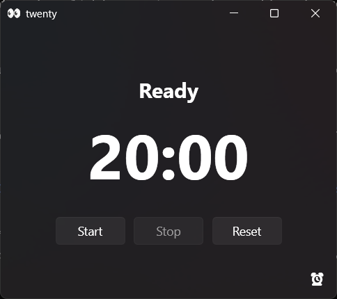
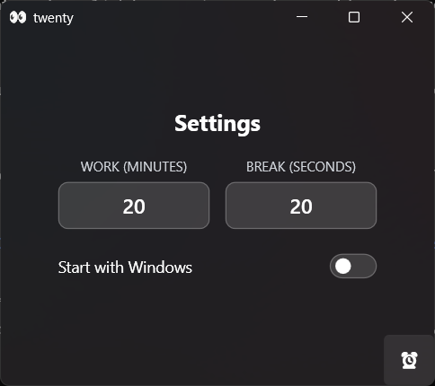
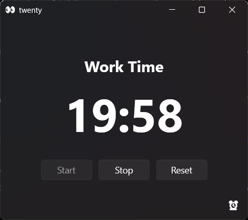
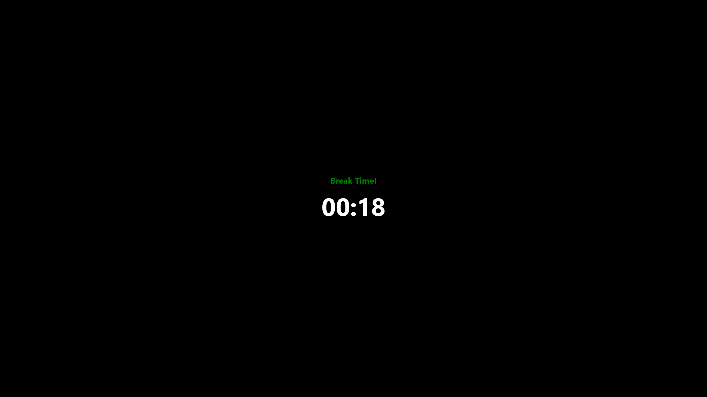

# twenty 👀

A lightweight app that enforces the 20-20-20 rule with gentle reminders to rest your eyes and reduce digital eye strain.

**What is the 20-20-20 rule?** - Every 20 minutes, take a 20 second break by looking at least 20 feet away.

It forces you to take a break by taking over your screen with an overlay for 20 seconds with no way to remove it. You must take a break for 20 seconds before it lets you back to your screen.

## Mac

The Mac version is built with SwiftUI. It is an entirely menubar based app.

I do not have the paid Apple developer account currently. Because of this, Apple will block you trying to open the app because of security reasons.

To get around this, download the app and try to open it. Opening will be blocked.

Go to Settings > Privacy & Security > Security > Open Anyway

---

## Windows

The Windows version is built with C# and WPF (.NET 9). It follows your Windows light or dark theme and uses the Windows 11 Mica background.

  
  

### Download

Download `twenty-<version>-windows-x64.exe` from the [Releases](../../releases) page and run it. It is one file. You do not need to install .NET or anything else.

The app is not code-signed, so Windows SmartScreen may show "Windows protected your PC". Click **More info**, then **Run anyway**.

### Features

- **Break overlay on every monitor.** When a break starts, a black screen with a countdown covers each monitor you have. You cannot remove it until the break ends.
- **System tray.** The close button hides the window. The app keeps running in the system tray. To close it fully, right-click the tray icon and choose **Exit**.
- **Start with Windows.** Turn on the switch in settings. The app then starts hidden in the tray at sign-in and starts the timer.
- **Saved settings.** The work time (minutes) and break time (seconds) are saved between sessions. The defaults are 20 minutes and 20 seconds.

### Use

1. Click **Start**. The timer counts down your work time.
2. Click the alarm clock button in the bottom-right corner to open settings. The timer and buttons are hidden while settings are open. Click it again to close settings.
3. When the timer ends, the break screen appears.

  

The break screen, shown on every monitor:

